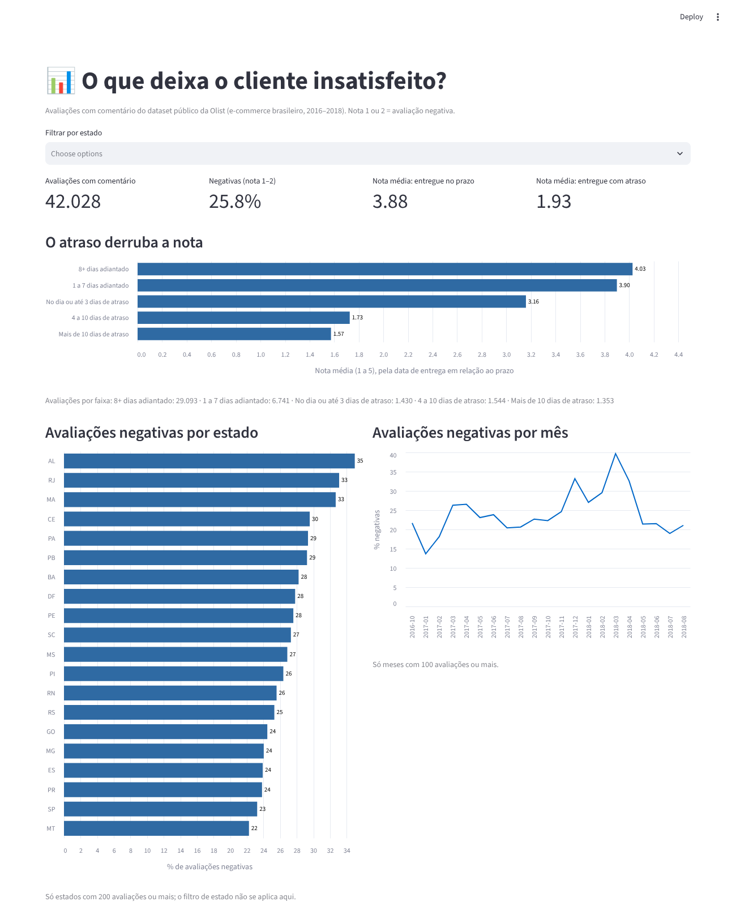

# 📊 Analisador de Avaliações: LLM vs ML clássico

Classificação de **42 mil avaliações reais** de clientes de e-commerce brasileiro por **sentimento** e **motivo da reclamação**, comparando um modelo de machine learning clássico com um LLM, mais um dashboard que mostra o que deixa o cliente insatisfeito.



## Pergunta que o projeto responde

Para classificar milhares de avaliações, vale mais um modelo clássico treinado nos dados (barato e rápido) ou um LLM com um bom prompt (sem treino e capaz de dizer o **motivo** da reclamação)? Onde cada um erra?

## Principais resultados

**1. O atraso na entrega é o que mais derruba a nota.** Pedidos entregues com atraso têm nota média **1,93**, contra **3,88** dos entregues no prazo. Entre os atrasados, **73%** das avaliações são negativas; entre os entregues no prazo, **21%**.

**2. Para sentimento, o modelo clássico já resolve muito bem.** TF-IDF com regressão logística, treinado em 31 mil avaliações em menos de 1 segundo:

| Conjunto | Acurácia | F1 macro | Recall das negativas |
|---|---|---|---|
| Teste completo (7.689 avaliações, proporção real) | 93,7% | 0,925 | 95,4% |
| Amostra balanceada usada na comparação (400) | 95,5% | 0,955 | 98,5% |

Os termos que mais pesam para "negativa" são *não recomendo*, *não recebi*, *péssimo*, *quebrado*; para "positiva", *recomendo*, *excelente*, *antes* (do prazo), *rápida*.

**3. O LLM entra onde o clássico não alcança: o motivo.** O modelo clássico só sabe dizer "negativa"; o LLM diz *por quê* (atraso, produto errado, defeito...), sem nenhum exemplo rotulado de motivo. A comparação na mesma amostra fica em [resultados/comparacao.md](resultados/comparacao.md), gerada por `scripts/comparar.py`.

<!-- Depois de rodar com a chave do Gemini, resuma aqui a linha do LLM: acurácia, tempo e custo por 1.000 avaliações. -->

## Como funciona

| Etapa | Arquivo | O que faz |
|---|---|---|
| Dados | `src/dados.py` | Junta avaliações, pedidos e clientes; calcula dias de atraso; rótulo 1-2 = negativa, 4-5 = positiva (nota 3 sai, por ser ambígua) |
| Modelo clássico | `src/classico.py` | TF-IDF (palavras e pares de palavras, sem acento) + regressão logística com classes balanceadas |
| LLM | `src/llm.py` | Gemini com **saída estruturada**: um esquema JSON obriga cada resposta a ter sentimento e um motivo de uma lista fechada |
| Comparação | `scripts/comparar.py` | Mesma amostra balanceada para os dois: acurácia, F1, recall, tempo e custo por 1.000 avaliações, e os casos em que discordam |
| Motivos | `scripts/classificar_motivos.py` | Classifica o motivo de 1.000 avaliações negativas e confere o LLM contra as datas reais de entrega |
| Dashboard | `dashboard.py` | Streamlit com nota por faixa de atraso, negativas por estado e por mês, motivos e a comparação |

### Decisões técnicas

- **Amostra balanceada na comparação.** No dataset, 72% das avaliações são positivas: um modelo que sempre responde "positiva" já acertaria 72%. Com metade de cada classe, a acurácia fica honesta. O resultado no teste completo também é reportado.
- **Lotes de 20 avaliações por chamada ao LLM.** Reduz em 20 vezes o número de requisições, o que importa na camada gratuita da API. Cada avaliação vai numerada e a resposta é casada pelo número.
- **Saída estruturada em vez de texto livre.** O SDK envia um esquema (Pydantic) e o modelo só pode responder com os valores permitidos. Respostas fora do formato viram "inválido" e entram nas métricas, em vez de quebrar o script.
- **Cache em disco.** Cada classificação é salva assim que chega. Se o limite da API estourar no meio, rodar de novo continua de onde parou, sem pagar duas vezes.
- **Validação do LLM com um dado que ele não vê.** O LLM lê só o comentário. As datas de entrega dizem se o pedido realmente atrasou, então dá para medir com que frequência ele aponta "atraso" nos pedidos que de fato atrasaram.

## Como rodar

Pré-requisitos: Python 3.10+ e uma chave gratuita da API do Gemini ([Google AI Studio](https://aistudio.google.com/apikey)) para a parte de LLM.

```bash
git clone https://github.com/MatGIT19/analise-avaliacoes-llm.git
cd analise-avaliacoes-llm
python -m venv .venv && source .venv/bin/activate   # Windows: .venv\Scripts\activate
pip install -r requirements-dev.txt
cp .env.example .env                    # coloque sua chave em GEMINI_API_KEY

python scripts/baixar_dados.py          # ~40 MB, cópia oficial da Olist no GitHub
python scripts/comparar.py --sem-llm    # só o modelo clássico, sem chave
python scripts/comparar.py              # clássico + LLM (400 avaliações = 20 chamadas)
python scripts/classificar_motivos.py   # motivos de 1.000 avaliações negativas (50 chamadas)
streamlit run dashboard.py              # dashboard
pytest -q                               # 10 testes, sem chamar a API
```

Se o modelo padrão não estiver disponível na sua conta, troque `LLM_MODEL` no `.env`.

## Dados

[Brazilian E-Commerce Public Dataset by Olist](https://www.kaggle.com/datasets/olistbr/brazilian-ecommerce): 99 mil pedidos de 2016 a 2018, dos quais 42 mil têm comentário escrito. Licença CC BY-NC-SA 4.0; os arquivos não ficam neste repositório. Detalhes em [data/README.md](data/README.md).

## Estrutura

```
src/          carga dos dados, modelo clássico, classificador LLM e métricas
scripts/      baixar_dados.py, comparar.py, classificar_motivos.py
dashboard.py  dashboard em Streamlit
resultados/   métricas e tabelas geradas pelos scripts
tests/        pytest com dados sintéticos e um cliente falso do Gemini
docs/         imagens deste README
```

## Próximos passos

- Testar um modelo pequeno do Hugging Face para português (como um BERT em português) no lugar do TF-IDF.
- Pedir ao LLM mais de um motivo por avaliação, já que muitas reclamações misturam atraso e produto errado.

---

Feito por **Matteus Prado** · [LinkedIn](https://www.linkedin.com/in/matteus-prado-31b18a364) · [GitHub](https://github.com/MatGIT19)
